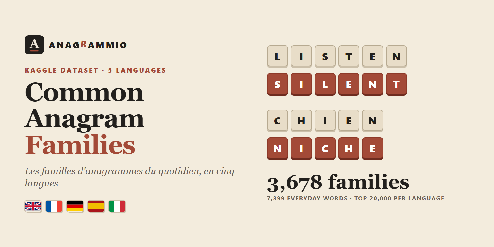

# Common Anagram Families In 5 Languages



**English first, version française complète plus bas. Kurzfassung auf Deutsch, resumen en español e sintesi in italiano at the end.**

## Everyday Anagram Families In Five Languages

STOP, SPOT, POST, TOPS. CHIEN, NICHE. AMPEL, LAMPE, PALME.

Two words are anagrams when they use exactly the same letters. This dataset gathers **3,678 anagram families** and **7,899 words** in 🇬🇧 English, 🇫🇷 French, 🇩🇪 German, 🇪🇸 Spanish and 🇮🇹 Italian. Every word in it is among the 20,000 most frequent words of its language, so these are the anagrams people actually recognise, not the obscure forms that fill raw dictionary dumps.

Public dataset hubs have word lists and frequency lists, mostly in English, but no real list of anagram families, and none across several languages. This one comes from [Anagrammio](https://www.anagrammio.com), a free anagram solver in five languages, where each word has its own page with all its anagrams, the words hidden in its letters and its first-name anagrams.

### What Is In The File

| | |
|---|---|
| Families | 3,678 groups of two words or more |
| Rows | 7,899 words, one row per word |
| Languages | `en`, `fr`, `de`, `es`, `it` |
| Word length | 3 to 14 letters |
| Selection | each word ranks in the top 20,000 of its language (OpenSubtitles 2018 frequency) |

| language | families | words |
|---|---|---|
| 🇬🇧 English | 576 | 1,230 |
| 🇫🇷 French | 781 | 1,668 |
| 🇩🇪 German | 673 | 1,447 |
| 🇪🇸 Spanish | 839 | 1,823 |
| 🇮🇹 Italian | 809 | 1,731 |

A few families picked from the file.

| language | family |
|---|---|
| en | live, evil, veil, vile |
| en | listen, silent, enlist |
| fr | merci, crime |
| fr | image, magie |
| de | Erde, Rede |
| es | sentido, destino |
| it | meglio, moglie |

### How Anagrams Are Matched

Letters are compared after removing accents, so French `écart` and `trace` share a family. German keeps **ä, ö and ü** as letters of their own (BAR and BÄR are not anagrams) and writes **ß** as `ss`. Spanish keeps **ñ** as its own letter. Each family has a `letters` key, the sorted letters shared by all its members.

Only everyday vocabulary is kept. Acronyms, slurs, two-letter words and proper names are left out. In German, nouns keep their capital letter, as in any German text.

### Columns

| column | description |
|---|---|
| `family_id` | Stable family identifier, such as `fr-01234` |
| `language` | `en`, `fr`, `de`, `es` or `it` |
| `letters` | Sorted letters of the family, accents removed (ä, ö, ü, ñ kept) |
| `length` | Number of letters |
| `word` | The word with its usual spelling and accents |
| `word_plain` | The word in lower case, accents removed |
| `frequency_rank` | Rank in the OpenSubtitles 2018 frequency list of the language (1 is the most frequent) |
| `family_size` | Number of words of the family in this file |
| `url` | The word's page on anagrammio.com, with every anagram, including rarer ones |

### What You Can Do With It

- **Make word games.** Pick a family, show one word and ask for the others.
- **Teach languages.** Common words that hide each other are a fun way to work on spelling.
- **Compare languages.** See how often everyday words collide in each language and why.
- **Test models on letters.** Pair it with the companion benchmark to see whether a model can rearrange letters.

### Limitations

This is a sample, not a full anagram dictionary. A family may have rarer members that are not in the file (they are on each word's page on the site). Frequencies come from film and TV subtitles, so spoken words rank higher than written ones. Inflected forms are counted, which gives French and Spanish many verb families.

### License And Citation

**CC BY-SA 4.0**, because the word lists derive from Wiktionary. Use it, share it and adapt it, commercially or not, under the same license, and credit **Anagrammio** with a link to **[anagrammio.com](https://www.anagrammio.com)**.

```bibtex
@misc{anagrammio_anagram_families_2026,
  title  = {Common anagram families in five languages},
  author = {{Anagrammio}},
  year   = {2026},
  url    = {https://www.anagrammio.com},
  note   = {Hugging Face dataset}
}
```

Sources. Word lists from Wiktionary through kaikki.org (CC BY-SA), with Kartmaan french-language-tools and hbenbel French-Dictionary (MIT) for French, SCOWL for English, Morph-it! (CC BY-SA 2.0) for Italian and doozan spanish_data (CC BY 4.0) for Spanish. Word frequencies from FrequencyWords by Hermit Dave, built on OpenSubtitles 2018 (CC BY-SA).

Companion datasets, **[Anagram Benchmark For LLMs | 5 Languages](https://huggingface.co/datasets/anagrammio/anagram-benchmark-llm)** and **[Anagram Statistics | 5 Languages](https://huggingface.co/datasets/anagrammio/anagram-statistics)**.

Also on Kaggle, **[Common Anagram Families | 5 Languages](https://www.kaggle.com/datasets/cuivrax/common-anagram-families-5-languages)**, with a starter notebook.

---

## Version Française

### Les Familles D'Anagrammes Du Quotidien, En Cinq Langues

CHIEN, NICHE. MERCI, CRIME. IMAGE, MAGIE.

Deux mots sont des anagrammes quand ils utilisent exactement les mêmes lettres. Ce jeu de données réunit **3 678 familles d'anagrammes** et **7 899 mots** en anglais, français, allemand, espagnol et italien. Chaque mot fait partie des 20 000 mots les plus fréquents de sa langue. Ce sont donc les anagrammes que tout le monde reconnaît, pas les formes obscures des dictionnaires bruts.

Les plateformes de données ont des listes de mots et de fréquences, surtout en anglais, mais aucune vraie liste de familles d'anagrammes, et aucune en plusieurs langues. Celle-ci vient d'[Anagrammio](https://www.anagrammio.com), un anagrammeur gratuit en cinq langues, où chaque mot a sa page avec toutes ses anagrammes, les mots cachés dans ses lettres et ses anagrammes en prénoms.

### Contenu Du Fichier

| | |
|---|---|
| Familles | 3 678 groupes d'au moins deux mots |
| Lignes | 7 899 mots, un par ligne |
| Langues | `en`, `fr`, `de`, `es`, `it` |
| Longueur | 3 à 14 lettres |
| Sélection | chaque mot est dans les 20 000 premiers de sa langue (fréquences OpenSubtitles 2018) |

### Comment Les Anagrammes Sont Reconnues

Les lettres sont comparées sans les accents, donc `écart` et `trace` sont dans la même famille. L'allemand garde **ä, ö et ü** comme des lettres à part et écrit **ß** en `ss`. L'espagnol garde le **ñ**. La colonne `letters` donne les lettres triées communes à toute la famille.

Seul le vocabulaire courant est gardé. Les sigles, les insultes, les mots de deux lettres et les noms propres sont écartés.

### Colonnes

| colonne | description |
|---|---|
| `family_id` | Identifiant stable de la famille, par exemple `fr-01234` |
| `language` | `en`, `fr`, `de`, `es` ou `it` |
| `letters` | Lettres triées de la famille, sans accents (ä, ö, ü, ñ gardés) |
| `length` | Nombre de lettres |
| `word` | Le mot avec son orthographe et ses accents |
| `word_plain` | Le mot en minuscules, sans accents |
| `frequency_rank` | Rang dans la liste de fréquences OpenSubtitles 2018 de la langue (1 = le plus fréquent) |
| `family_size` | Nombre de mots de la famille dans ce fichier |
| `url` | La page du mot sur anagrammio.com, avec toutes ses anagrammes, y compris les plus rares |

### À Quoi Ça Sert

- **Créer des jeux de lettres.** On montre un mot de la famille et on fait deviner les autres.
- **Enseigner les langues.** Des mots courants qui se cachent l'un l'autre, c'est une façon ludique de travailler l'orthographe.
- **Comparer les langues.** Voir à quelle fréquence les mots du quotidien se rencontrent, langue par langue.
- **Tester des modèles sur les lettres**, avec le banc d'essai associé.

### Limites

C'est un échantillon, pas un dictionnaire complet. Une famille peut avoir des membres plus rares absents du fichier, ils sont sur la page de chaque mot. Les fréquences viennent de sous-titres de films et de séries, donc les mots de l'oral sont mieux classés. Les formes conjuguées comptent, d'où les nombreuses familles de verbes en français et en espagnol.

### Licence Et Citation

**CC BY-SA 4.0**, car les listes de mots dérivent du Wiktionnaire. Vous pouvez utiliser, partager et adapter ces données, y compris pour un usage commercial, sous la même licence, en citant **Anagrammio** avec un lien vers **[anagrammio.com](https://www.anagrammio.com)**.

---

### 🇩🇪 Kurzfassung

3.678 Anagramm-Familien und 7.899 Wörter in fünf Sprachen, nur aus den 20.000 häufigsten Wörtern jeder Sprache, etwa ERDE und REDE oder AMPEL, LAMPE und PALME. Ä, Ö und Ü zählen als eigene Buchstaben, ß als ss. Jede Zeile verlinkt auf die Wortseite bei [Anagrammio](https://www.anagrammio.com/de/). Lizenz CC BY-SA 4.0.

### 🇪🇸 Resumen

3.678 familias de anagramas y 7.899 palabras en cinco idiomas, solo entre las 20.000 palabras más frecuentes de cada uno, como SENTIDO y DESTINO o NOVIA y AVIÓN. La Ñ cuenta como letra propia. Cada fila enlaza con la ficha de la palabra en [Anagrammio](https://www.anagrammio.com/es/). Licencia CC BY-SA 4.0.

### 🇮🇹 Sintesi

3.678 famiglie di anagrammi e 7.899 parole in cinque lingue, scelte fra le 20.000 parole più frequenti di ciascuna, come MEGLIO e MOGLIE o CIELO e LICEO. Ogni riga rimanda alla scheda della parola su [Anagrammio](https://www.anagrammio.com/it/). Licenza CC BY-SA 4.0.


---

**Part of [Verbarium](https://github.com/verbarium)**, open word data for word games and language tools. Data by [Anagrammio](https://www.anagrammio.com/). Also on [Kaggle](https://www.kaggle.com/datasets/cuivrax/common-anagram-families-5-languages) and [Hugging Face](https://huggingface.co/datasets/anagrammio/common-anagram-families).
